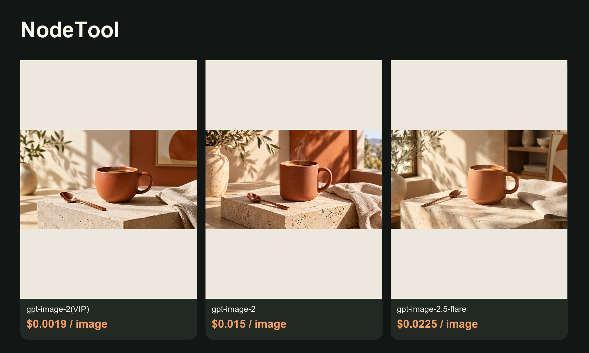

# ToAPIs · 更低成本的 NodeTool 图片与视频素材方案


<!-- TOAPIS-MODELS-20261020 -->
## 模型与价格更新 · 2026-10-20

新增可独立运行的31套图片请求模板、8套视频模板。当前26套图片与8套视频可匹配同Key精确价格；另5套图片缺价，默认阻止新付费调用。它们属于额外API脚本；项目原生Provider、UI、导入及完整出片的验收范围仍以下方原教程为准。

| 图片模型／实测档位 | 当前档位报价／张 | 历史案例金额／张 | 费用证据 |
|---|---:|---:|---|
| gpt-image-2(VIP)<br><sub>low</sub> | $0.0019/image | **$0.0019/image** | 计费日志，阶段未知 |
| gpt-image-2.5-flare-vip<br><sub>low</sub> | 当前Key暂未返回报价 | **$0.005272/image**<br><sub>Token计费；当前$/M未返回，本例金额不是固定单张价。</sub> | 任务回执已结算 |
| nano_banana<br><sub>1K</sub> | $0.012/image | **$0.012/image** | 计费日志，阶段未知 |
| gemini-nano-banana-2.1<br><sub>1K</sub> | $0.015/image | **$0.015/image** | 计费日志，阶段未知 |
| gpt-image-2<br><sub>1K</sub> | $0.015/image | **$0.015/image** | 计费日志，阶段未知 |
| gemini-nano-banana-2.1-vip<br><sub>1K</sub> | $0.02/image | **$0.02/image** | 计费日志，阶段未知 |
| qwen-image-3.0<br><sub>1K</sub> | 当前Key暂未返回报价 | **$0.021/image** | 计费日志，阶段未知 |
| gpt-image-2.5-flare<br><sub>high</sub> | $0.0225/image | **$0.0225/image** | 计费日志，阶段未知 |
| gpt-image-2.5-sunburst<br><sub>high</sub> | $0.0225/image | **$0.0225/image** | 计费日志，阶段未知 |
| flux-2-pro<br><sub>1K</sub> | $0.025/image | **$0.025/image** | 计费日志，阶段未知 |
| doubao-seedream-5-0-pro<br><sub>1K</sub> | $0.042857/image | **$0.042856/image** | 计费日志，阶段未知 |

| 视频模型 | 档位／输入 | 本例消费 | 文件时长 | 本例每秒金额（升序） |
|---|---|---:|---:|---|
| MiniMax-H3-Max-Turbo | 5s / 480P / 文生视频 | $0.125/clip | 5.18s | **$0.024131/s**<br><sub>pricing底层费率：$0.025/s</sub> |
| seedance-2-mini | 4s / 480p / 首帧 | $0.13338/clip | 4.04s | **$0.033015/s**<br><sub>pricing底层费率：$3.285714/M total tokens</sub> |
| seedance-2-fast | 4s / 480p / 文生视频 | $0.214568/clip | 4.04s | **$0.053111/s**<br><sub>pricing底层费率：$5.285714/M total tokens</sub> |
| kling-v3 | 5s / 720p / std / 文生视频 | $0.3/clip | 5.04s | **$0.059524/s**<br><sub>pricing底层费率：$0.06/s</sub> |
| MiniMax-H3 | 5s / 768p / 文生视频 | $0.32/clip | 5.17s | **$0.061896/s**<br><sub>pricing底层费率：$0.064/s</sub> |
| seedance-2 | 4s / 480p / 首帧 | $0.26676/clip | 4.04s | **$0.06603/s**<br><sub>pricing底层费率：$6.571429/M total tokens</sub> |
| kling-3.0-turbo | 4s / 720p / 文生视频 | $0.32/clip | 4.04s | **$0.079208/s**<br><sub>pricing底层费率：$0.08/s</sub> |
| seedance-2-5 | 4s / 480p / 文生视频 | $0.3883/clip | 4.04s | **$0.096114/s**<br><sub>pricing底层费率：$10/M total tokens</sub> |

报价核对：2026-10-20。图片案例日期2026-10-17；视频案例日期2026-10-20。表格按本例金额／秒金额排序，质量、分辨率和输入不同，不是同配置质量排名。图片日志的阶段未知，不能当作单任务最终净结算；当前报价与历史金额分别显示。视频金额均由billing=settled确认，$/s按实际文件时长折算，任务处理耗时不参与计算。Token模型不是固定每秒价，底层$/M只作小字补充。

gpt-image-2(VIP)通用价格为$0.0019/image起；本例low/1K为$0.0019/image。新脚本有31套历史成功图片请求模板、8套视频模板；当前26套图片与8套视频可匹配价格，另5套图片因当前Key缺价而默认阻止新付费调用。

[本仓库多模型脚本](toapis-models/README_zh-CN.md) · [完整价表](PRICING_zh-CN.md) · [原图／视频及费用证据](https://github.com/ToAPIs-2025/toapis-quickstart/tree/main/tutorials/model-support-2026-10-20)

下方保留原项目历史案例、消费及集成说明；历史金额不改成今天的新报价。

<!-- /TOAPIS-MODELS-20261020 -->

同一个提示词，三个图片模型，保留原图、调用代码、参数和价格。另附一条首帧视频。

[English](README.md) · [对应模型与价格](https://go2v.toapis.com/1019_node_g) · [原项目](https://github.com/nodetool-ai/nodetool)

ToAPIs 独立维护的社区教程。当前验证边界：Loopback OpenAI-compatible bridge for existing custom image/video endpoints; app UI pending。这不是上游官方发行版或完整UI验收。

## 演示



[](examples/seedance-2-mini.mp4)

[打开／下载视频](examples/seedance-2-mini.mp4)：seedance-2-mini，请求4秒、720p、首帧图输入、无声；实际解码4.04秒，API已结算 **$0.286842**，本例折算 **$0.071/s**。首帧图片单独计费。

## 价表与案例费用

实测日期：2026-10-19，按本例展示金额从低到高排序。图片“报价”来自同一生成Key的精确档位查询；未收到单任务结算回执时不称为已确认实扣。视频金额来自API已结算回执。

| 模型／本次档位 | 类型 | 本例金额／报价 | 对应模型价格 | 费用依据 |
|---|---|---:|---|---|
| gpt-image-2(VIP)<br>low / 1K | 图片 | 报价 $0.0019 | $0.0019/image | 当期精确档位报价；单任务未返回结算，同模型批次日志另有记录 |
| gpt-image-2<br>1K | 图片 | 报价 $0.015 | $0.015/image | 当期精确档位报价；单任务未返回结算，同模型批次日志另有记录 |
| gpt-image-2.5-flare<br>high / 1K | 图片 | 报价 $0.0225 | $0.0225/image | 当期精确档位报价；单任务未返回结算，同模型批次日志另有记录 |
| seedance-2-mini<br>4s requested / 720p / 4.04s decoded / no audio | 视频 | $0.286842 | $3.285714/1M total tokens; this clip $0.071/s | API回执已结算 |

**gpt-image-2(VIP)，$0.0019/image 起；本例 low/1K 就是 $0.0019/image。** 代码保留真实ID `gpt-image-2-vip`。Seedance按总token计费，美元/秒是具体案例折算，非固定秒价。

## 复用

复制 `.env.example` 为私有 `.env`，设置生成Key和独立的本地桥接令牌。先查价，再明确添加 `--live` 提交。

```bash
python run_case.py --job jobs/gpt-image-2-vip.json
python run_case.py --job jobs/gpt-image-2-vip.json --live
python bridge.py
```

[各项目配置和验收边界](integration/README.md) · [参数输入](jobs/) · [脱敏案例证据](evidence/) · [验收清单](ACCEPTANCE.md)

提交前保存任务；查询失败仅继续GET同一任务，提交响应丢失不自动重提。不要仅因支持自定义Key/Base URL就判定图片或视频即插即用。

固定上游版本：[8c61c32f188a](https://github.com/nodetool-ai/nodetool/commit/8c61c32f188ae6bf9ec95ec09d06556985ec41b4)。图片和视频原始素材生成成功，不代表已完成上游产品全流程。

## 原创提示词

```text
Cinematic wide 16:9 product storyboard still: a matte terracotta ceramic coffee cup on a pale stone plinth in a sunlit design studio, steam gently rising, one copper spoon and one linen napkin, strong natural shadows, warm cream and rust palette, high-end original product photography, no logo, no text, no people, no watermark.
```

